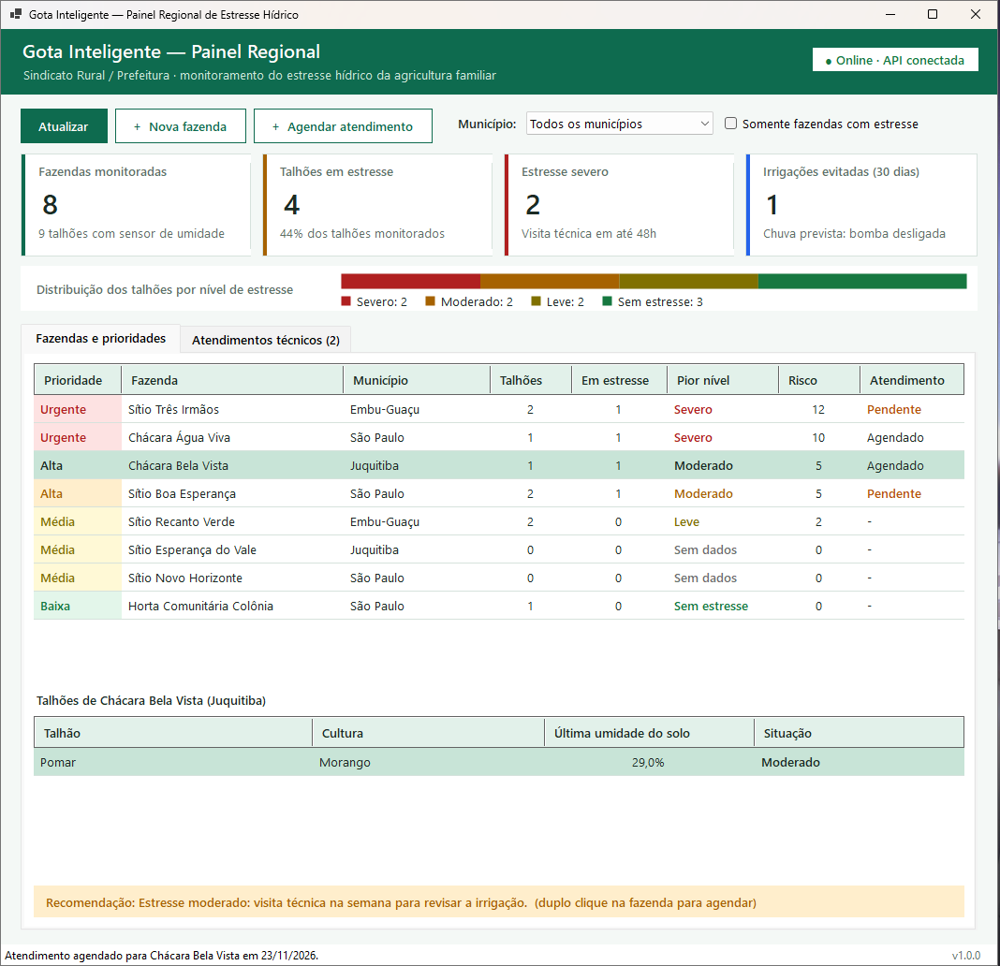
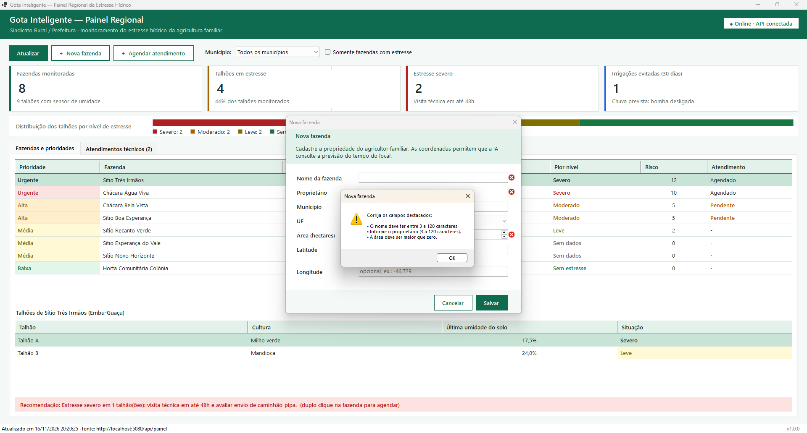
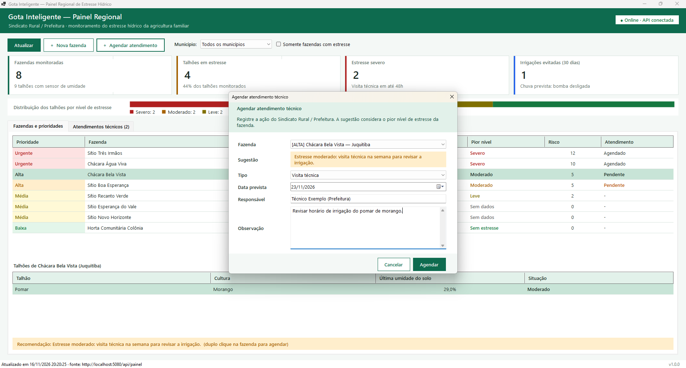
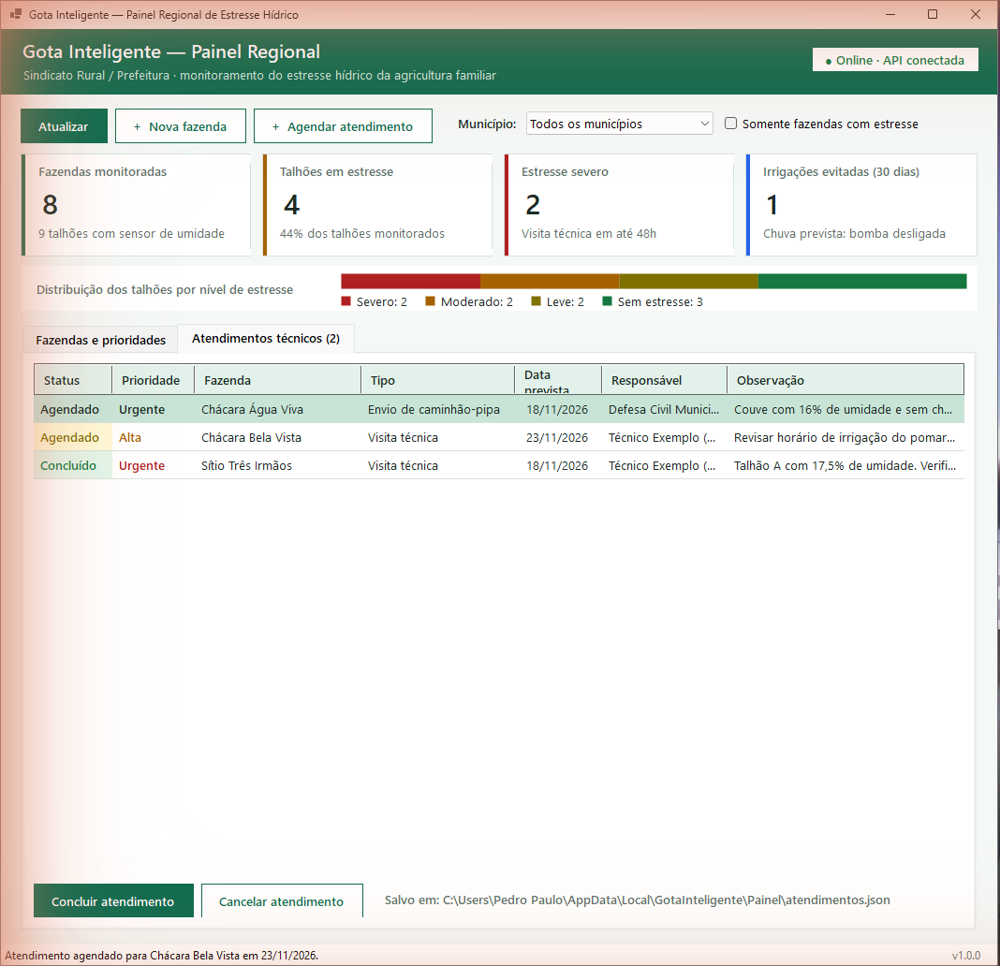
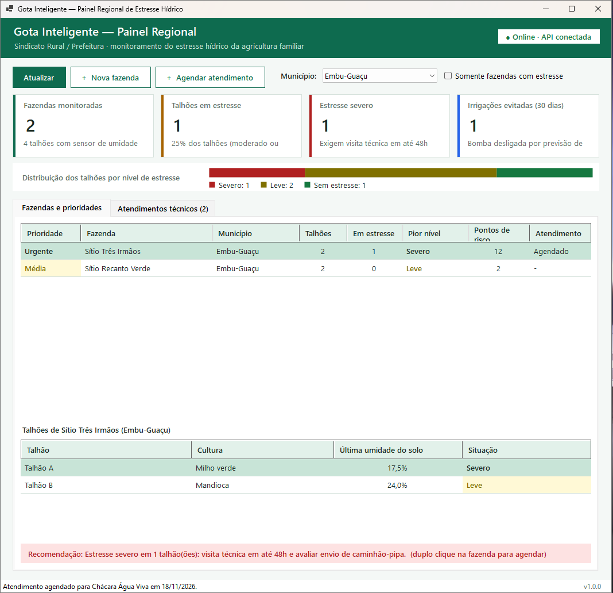
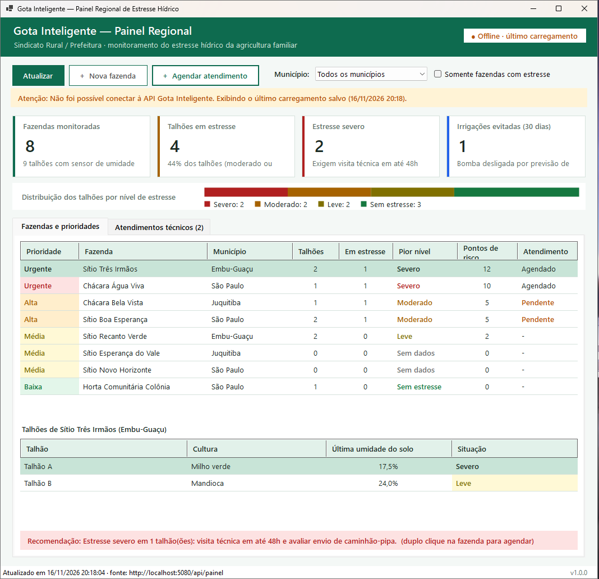

# 💧 Gota Inteligente — Painel Regional (C# Windows Forms)

> Global Solution 2026.2 · FIAP · Engenharia de Software · CitizenTech
> Disciplina: **C# Software Development** · Equipe **Gota Inteligente**

Painel desktop para o **Sindicato Rural** e a **Prefeitura** acompanharem o **estresse hídrico** das propriedades da agricultura familiar da região, decidirem **quem atender primeiro** e registrarem os **atendimentos técnicos**.



## O problema

O pequeno produtor rega "no olhômetro": desperdiça água e energia elétrica ou perde a plantação numa seca repentina. A CitizenTech **Gota Inteligente** mede a umidade do solo com um ESP32, cruza com a previsão do tempo (IA) e avisa o agricultor pelo app.

Faltava a visão **regional**: quem dá assistência técnica não sabia quais fazendas estavam em situação crítica para priorizar as visitas e o envio de caminhão-pipa.

## Quem é beneficiado

| Papel | Quem é | O que ganha com o painel |
|---|---|---|
| **Usuário do sistema** | Técnico de extensão rural do Sindicato Rural e servidor da Secretaria de Agricultura da Prefeitura | Vê as fazendas em estresse em segundos e sabe por onde começar |
| **Beneficiado final** | Agricultor familiar da zona rural do extremo sul de São Paulo (Parelheiros) e municípios vizinhos (Embu-Guaçu, Juquitiba) | Recebe visita técnica ou caminhão-pipa antes de perder a plantação |

## Funcionalidades

- **Indicadores da região:** fazendas monitoradas, talhões em estresse, talhões em estresse severo e irrigações evitadas pela IA nos últimos 30 dias.
- **Distribuição por nível** (Severo, Moderado, Leve, Sem estresse) numa barra empilhada.
- **Fila de prioridades:** fazendas ordenadas por prioridade (Urgente → Baixa) e pontuação de risco, com cores por nível.
- **Talhões da fazenda selecionada** com a última umidade do solo e a **recomendação automática** de atendimento.
- **Filtros** por município e "somente fazendas com estresse" (os indicadores acompanham o filtro).
- **Cadastro de fazenda** com validação campo a campo, enviado para a API REST.
- **Agendamento de atendimento técnico** com sugestão automática de tipo e prazo, e controle de status (Agendado, Concluído, Cancelado, Atrasado).
- **Modo offline:** se a API cair, o painel mostra o último carregamento salvo (ou dados simulados) e avisa o usuário.

| Cadastro com validação | Agendamento com sugestão |
|---|---|
|  |  |

| Atendimentos técnicos | Filtro por município | Modo offline |
|---|---|---|
|  |  |  |

## Lógica e algoritmos

**Prioridade de atendimento** (`FazendaMonitorada.Prioridade`), a partir do pior nível entre os talhões:

| Pior nível da fazenda | Prioridade | Recomendação (`RecomendacaoAtendimento`) |
|---|---|---|
| Severo | **Urgente** | Visita técnica em até 48h e avaliar caminhão-pipa |
| Moderado | **Alta** | Visita técnica na semana |
| Leve | **Média** | Orientação remota sobre horários de irrigação |
| Sem dados | **Média** | Instalar ou verificar o sensor ESP32 em campo |
| Sem estresse | **Baixa** | Manter o monitoramento semanal |

**Pontuação de risco** (`PontuacaoRisco`): soma dos pesos dos talhões (Severo 10, Moderado 5, Leve 2, Sem dados 1). Desempata fazendas com a mesma prioridade, então quem tem mais talhões críticos aparece antes.

**Validações:**
- Fazenda: nome e proprietário com 3 a 120 caracteres, UF válida, área maior que zero, latitude entre -90 e 90 e longitude entre -180 e 180 (aceita vírgula ou ponto), coordenadas preenchidas juntas.
- Atendimento: fazenda e tipo obrigatórios, data entre hoje e 90 dias, responsável com no mínimo 3 letras, observação com até 300 caracteres. Só um atendimento **agendado** pode ser concluído ou cancelado.
- Os erros aparecem ao lado de cada campo (`ErrorProvider`). Os erros de validação da própria API também são mapeados para os campos.

## Programação Orientada a Objetos

```
GotaInteligente.Painel/
├── Dominio/     Regras de negócio, sem dependência de tela
│   ├── FazendaMonitorada, TalhaoMonitorado   (encapsulamento: só leitura, validação no construtor)
│   ├── AtendimentoTecnico                    (fábrica Agendar(), métodos Concluir()/Cancelar())
│   ├── NovaFazenda, ValidacaoException       (validação campo a campo)
│   ├── RecomendacaoAtendimento, ResumoRegional
│   └── NivelEstresse, Prioridade             (enums + métodos de extensão)
├── Servicos/    Integração e persistência
│   ├── ApiGotaInteligente    Cliente HTTP da API REST (SOA)
│   ├── ServicoPainel         API → cache → dados simulados
│   ├── CachePainel           Último carregamento em JSON
│   └── RepositorioAtendimentos  Atendimentos em JSON
├── Ui/          Componentes visuais reutilizáveis (Tema, CardIndicador, BarraDistribuicao)
└── Telas/       FormPrincipal, FormCadastroFazenda, FormAtendimento (herdam de FormBase)
```

- **Encapsulamento:** as entidades expõem só propriedades de leitura. O estado muda apenas por métodos com regra (`Concluir`, `Cancelar`).
- **Herança:** os formulários de cadastro herdam de `FormBase` (layout, botões e exibição de erros). `CardIndicador` e `BarraDistribuicao` estendem controles do Windows Forms com desenho próprio (`OnPaint`).
- **Separação de responsabilidades:** as telas não conhecem HTTP nem JSON. Elas falam com o `ServicoPainel` e o `RepositorioAtendimentos`.

## Persistência básica

Os arquivos ficam em `%LOCALAPPDATA%\GotaInteligente\Painel\`:

- `atendimentos.json`: atendimentos técnicos agendados, concluídos e cancelados.
- `cache-painel.json`: último painel carregado da API, usado no modo offline.

## Tecnologias

- C# 12 · .NET 8 · **Windows Forms**
- `HttpClient` e `System.Net.Http.Json` para consumir a API REST
- `System.Text.Json` para a persistência local
- Integração com a API [**gota-inteligente-soa**](https://github.com/Pedro-Sabino/gota-inteligente-soa) (ASP.NET Core, EF Core e SQLite)

## Como executar

**Pré-requisitos:** Windows 10 ou 11 e o [.NET 8 SDK](https://dotnet.microsoft.com/download/dotnet/8.0). Visual Studio 2022 é opcional.

1. **(Recomendado) Suba a API** do projeto de SOA para ter dados reais:
   ```powershell
   git clone https://github.com/Pedro-Sabino/gota-inteligente-soa.git
   cd gota-inteligente-soa\GotaInteligente.Api
   dotnet run
   ```
   A API sobe em `http://localhost:5080`. Para usar outro endereço, defina a variável de ambiente `GOTA_API_URL`.

2. **Rode o painel:**
   ```powershell
   git clone https://github.com/Pedro-Sabino/gota-inteligente-painel.git
   cd gota-inteligente-painel
   dotnet run --project GotaInteligente.Painel
   ```
   Ou abra o `GotaInteligente.Painel.sln` no Visual Studio e aperte **F5**.

> Sem a API, o painel abre em **modo offline**, com o último carregamento salvo ou com dados simulados. O cadastro de fazendas fica desabilitado nesse modo.

## Versionamento

- **Versionamento semântico** ([SemVer](https://semver.org/lang/pt-BR/)): versão `1.0.0` no `.csproj`, exibida no rodapé do painel e marcada com a tag `v1.0.0`.
- **Commits semânticos** ([Conventional Commits](https://www.conventionalcommits.org/pt-br/)): `feat`, `docs`, `chore`.
- **Fluxo com pull request:** o desenvolvimento aconteceu na branch `feature/painel-estresse-hidrico` e entrou na `main` via pull request. Veja o [`CHANGELOG.md`](CHANGELOG.md).

## Dados e privacidade

Todos os dados de fazendas e agricultores são **simulados** ("Agricultor Exemplo 1", "Agricultor Exemplo 2"...). Nenhum dado pessoal real é utilizado.

## Equipe Gota Inteligente

| Nome | RM |
|---|---|
| Henrique Maciel Rodrigues | RM559628 |
| Igor Pereira Nociti | RM560225 |
| João Pedro Vieira de Moais | RM560527 |
| Luigi Bonuccelli | RM560950 |
| Pedro Paulo Sabino Botelho | RM559578 |
